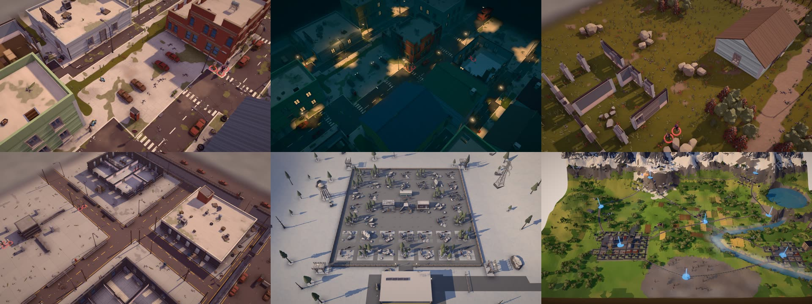

# Dirección de arte

Estado al 2026-10-14, con la versión 0.2.1. Lo lleva la sesión **Arte**, con los archivos de [EQUIPO.md](EQUIPO.md). La etapa anterior (laboratorio de estilos, vóxel, Expediente, Holotáctico, el Canto de Velmar) está en [archive/ARTE-historial.md](archive/ARTE-historial.md).



## Normas

- **De dónde sale el arte:** solo Synty POLYGON (con la suscripción de Arturo), Kenney (CC0) o lo hecho por nosotros. Tipografías OFL, como mucho dos familias. Nada de otros packs, aunque sean gratuitos.
- **El aspecto objetivo** son las capturas promocionales de Synty, en `assets-src/referencias/aspecto-synty/`.
- **Licencia:**
  - los originales viven en `assets-src/synty/` y no se suben;
  - al repositorio solo van los modelos convertidos que usa el juego, y por eso `Takeo7/Bastion` es siempre privado.
- **Rendimiento:**
  - ≤4,2 ms por fotograma en «alto» en el PC de referencia (Windows, RTX 3090), y «medio» a ≥30 fps en el Mac;
  - el aspecto no se recorta por el Mac: para eso están los ajustes;
  - se mide el tiempo de fotograma, no los fps.
- **Ritmo:** cada acción se ve entera antes de pasar a la siguiente, y la cámara nunca pelea con el jugador.
- **Lo rechazado no se vuelve a proponer:** vóxel, Expediente, Holotáctico, Viñeta, CRT y el resto del laboratorio de estilos.

## Los packs

Todos en `assets-src/synty/`. Las rutas de cada uno están en `PACKS` de `syntyManifest.ts`.

| Pack | Para qué |
|---|---|
| POLYGON Apocalypse | Supervivientes, saqueadores, rescatados, dos de los muertos, las armas y casi todo el decorado de la calle |
| POLYGON City Zombies | Los muertos comunes, los corredores y los acorazados. Solo viene como `.unitypackage`: el conversor lo desempaqueta una vez |
| POLYGON Boss Zombies | El Chillón y el Hinchado |
| POLYGON Town, City, Farm, Nature, Construction y Military | Los mapas de combate: edificios modulares, calles, campo, obras y controles militares |
| POLYGON Office, y dos de City | Las voces de la radio (`strategy/portraits.ts`) |
| Nature Biomes – Alpine Mountain y POLYGON Snow | La base en la sierra |
| ANIMATION – Base Locomotion e Idles | Las animaciones de todos los personajes |
| ANIMATION – Bow Combat y Sword Combat | Las muertes (`DEATHS`) |
| ANIMATION – Goblin Locomotion | Cómo andan y corren los muertos (`DEAD_MOTIONS`) |
| POLYGON Particle FX | Los efectos del combate y del Oficio |
| POLYGON Icons | Piezas para los renders de la interfaz |
| INTERFACE Apocalypse HUD, Modern Menus y Military Combat HUD | La interfaz (los lleva UX/UI) |

## La tubería

La explica [tools/synty/README.md](../packages/client/tools/synty/README.md).

- Una sola lista dice qué se usa y para qué: `src/game/syntyManifest.ts`. El conversor (`tools/synty/convert.ts`, con Blender) convierte exactamente eso a GLB en `public/models/synty/<pack>/`. Hoy son unos 12 MB.
- **Siempre con ids explícitos:**

  ```bash
  npx tsx packages/client/tools/synty/convert.ts hunter sofa
  ```

  Sin ids, o con `--force`, borra lo que no está en el manifiesto y podría llevarse lo nuevo de otra sesión.
- **Escala:** una casilla son 1,5 m (`SYNTY_SCALE`). Los kits modulares van en módulos de 2,5 m y se dibujan 1,2 veces más grandes (`KIT_SCALE`).
- **Materiales:** un atlas por pack, cargado una vez y compartido (`ATLASES`, `game/synty.ts`). Los ocho atlas del mapa van además en una sola textura (`game/mapAtlas.ts`).
- **Personajes:**
  - 22 huesos con los nombres de los packs de animación;
  - pelo, barba y sombrero rígidos, cada uno en su hueso;
  - un segundo mapa UV (`part`) dice qué se puede teñir.
- **Ajustes sin reconvertir:** el giro, el tamaño y el sitio de los objetos (`fit`, `yaw`, `shift` en `PROPS`) se aplican en el juego.

## Qué hay y dónde

### Personajes (`game/syntyFigures.ts`, `syntyAnims.ts`, `unitViews.ts`)

- **Supervivientes:** 16 personajes para elegir en el Cuartel (`SURVIVOR_CHOICES`). Sin elección, el soldado sale de su complexión y de su sexo (`SQUAD_BODIES`), y es el mismo en todas partes.
- **Los muertos:** comunes (10 modelos), corredores (4), acorazados (4, un poco más grandes), el Chillón y el Hinchado (`UNIT_BODIES`).
- **Animación,** por capas:
  - los clips de Base Locomotion e Idles se miden contra la pose en T del pack y se pasan a los huesos de cada personaje, así que el mismo clip sirve para los dos rigs de Synty;
  - encima, el torso (encogerse, impactos, retroceso, lanzar, tajo, mordisco, gritar) y los brazos: el arma en la mano derecha y la izquierda en el guardamanos, las dos con cinemática inversa;
  - la espera: la normal, con un vistazo o un cambio de peso de vez en cuando, o una postura propia (`STANCES`): los muertos se tambalean como borrachos, los Cuervos están en guardia y el soldado con la mitad de la vida o menos se encorva.
- **Velocidades** (`GAITS` en `gaits.ts`, la tabla que se afina; los segundos los decide Gameplay): cada plantilla tiene su paso, y el clip va a la velocidad que deja los pies quietos en el suelo (`clipSpeed`, medido: el pie apoyado no se desliza más de un ±8 %). Los muertos andan y corren con Goblin Locomotion, encorvados y arrastrando los pies.

  | Quién | Un movimiento (azul) | Dos (amarilla) |
  |---|---|---|
  | Los vivos (escuadra, Cuervos, VIP) | correr ×1,48 · 0,375 s | sprint ×0,81 · 0,24 s |
  | Agachado | andar agachado ×1,27 · 0,71 s | |
  | Muerto común | andar ×0,73 · 1,02 s, arrastrando un pie | andar ×0,97 · 0,77 s |
  | Corredor | correr ×0,87 · 0,52 s, encorvado | sprint ×1,19 · 0,20 s |
  | Acorazado | andar ×0,77 · 0,97 s, pesado | andar ×1,06 · 0,71 s |
  | El Chillón | andar ×0,81 · 0,92 s | andar ×1,13 · 0,66 s |
  | El Hinchado | andar ×0,69 · 1,08 s, bamboleándose | andar ×0,94 · 0,80 s |

  Son segundos por casilla; una diagonal tarda 1,4 veces más, una escalera de mano 1,2 s por planta y un tramo de escalera 1,6 veces la casilla. Todo va a la «Velocidad del combate» (`timeRate()` de `tween.ts`), los clips también.
- **Impactos** (`HITS` en `syntyManifest.ts`): las reacciones de Bow Combat (siete por complexión) para un golpe y las de Sword Combat (cuatro, con traspié) para un crítico, según de dónde venga, medido por hacia dónde va la cabeza. Un mordisco o un tajo lo doblan hacia delante. Mueven solo de la cintura para arriba: quien está agachado tras la cobertura sigue agachado. El combate espera 0,4 s, como antes, y la cola de la reacción sigue mientras pasa lo siguiente; si muere, la caída arranca desde la pose de la reacción (0,2 s de fundido).
- **Muertes** (`DEATHS` en `syntyManifest.ts`): seis clips por complexión, de Bow Combat y Sword Combat. El cuerpo cae lejos del golpe que lo mata: de un disparo de frente, de espaldas; por la espalda, de bruces; desde un lado, hacia el otro. Un crítico es un tiro a la cabeza, y un golpe cuerpo a cuerpo puede doblarlo sobre sí mismo. Entre las que encajan, cada unidad elige siempre la misma, y se queda con una que tenga sitio: ni pared ni cobertura alta en el camino, del ancho de los hombros, hasta donde llega la cabeza (`reach`). Si ninguna lo tiene, cae la que menos sitio ocupa. El clip se ve entero (de 0,9 a 1,5 s) y deja la pose final; el arma se suelta y queda en el suelo. Levantarse (Último verso, el zombi que sale del cadáver) es la muerte al revés.
- **Las armas de cada soldado** ([FASE8.md](FASE8.md) §A; `armamentOf` en `syntyFigures.ts`): en la campaña salen de `Unit.arms`, en la escaramuza de la plantilla.
  - En la mano, el arma de la Armería: fusil de asalto (por nivel, los tres de Apocalypse), escopeta, fusil de precisión, ametralladora; las buenas con modelo propio, el fusil de cerrojo limpio y la ametralladora ligera (la escopeta recortada y el fusil con mira usan la escopeta y el segundo fusil de precisión). Sin arma principal, la pistola, a dos manos: abajo en reposo y con los brazos estirados al apuntar.
  - Junto a un arma principal, la pistola va en su funda del muslo derecho. Al disparar con ella (`firesSidearm`), el arma principal pasa a la espalda, cruzada, y la pistola sale a la mano; al bajar el arma, vuelven a su sitio.
  - En la cadera izquierda, el cuchillo o el machete (un 80 % y un 72 % de su tamaño en Synty, que los hace largos al lado de los fusiles). Para el Tajo sale a la mano y el arma principal va a la espalda; luego vuelve.
  - Cambiar de arma en la misión (`weaponEquipped`): el arma se gira y baja como en una recarga, la mano izquierda va a la mochila y a mitad aparece la nueva (0,7 s).
  - En la base, el Cuartel y la fila de la misión muestran las mismas armas (`Gear.arms`).
- **Saltos y caídas** (`unitViews.ts`): saltar una ventana es subir agachado al alféizar y bajar o caer al otro lado; la caída dura más cuanto más alta es. Por un forjado roto, `fall()`: sin saltito, con tambaleo, agachado al tocar suelo.
- **Coste:** la pose se actualiza a 30 Hz en reposo o lejos, a 8 Hz fuera de pantalla y nada en la niebla o muertos. Solo los 24 enemigos más cercanos dan sombra. Las unidades van en su propia capa (`UNIT_LAYER`), fuera de la oclusión ambiental.
- **La multitud** (`crowd.ts`): un muerto en calma (andando o quieto) no se dibuja con su figura, sino con una malla instanciada para todos los de su cuerpo, con la animación horneada en una textura. Se hornea el andar y la postura, con todo lo que añade la figura (encorvado, brazos al frente, balanceo), desde una figura aparte que nadie ve, unos pocos fotogramas en cada tick. En cuanto hace otra cosa (le dan, ataca, muere, sube, se gira), vuelve a su figura; cuando se calma, a la multitud. Medido en el Mac con el laboratorio de hordas: 45 zombis, de 1,7 a 0,6 ms de CPU y de 86 a 41 llamadas de dibujo; 90, de 3,1 a 0,5 ms y de 131 a 41. Sigue el corte de los edificios como las figuras.
- **Retratos de la radio:** personajes de Synty en su panel (`strategy/portraits.ts`).
- **Sin reserva de primitivas:** `models.ts` y `figures.ts` solo guardan el contrato que mueven las vistas (`UnitRig`, `FigureRig`, `FigurePose`, `Gear`). Una plantilla sin personaje en el manifiesto sale como recluta y avisa en la consola.

### Mapas de combate (`game/mapView.ts`, `buildings.ts`, `ground.ts`, `dressing.ts`, `batch.ts`)

- **Edificios en los que se entra,** de los kits modulares:
  - el tejado se desvanece cuando se ve el interior por una ventana o una puerta;
  - las puertas se abren y se cierran girando sobre la bisagra, un cuarto de vuelta hacia dentro en 0,45 s (`doors.ts`): las hojas no van fusionadas con la pared, sino en una malla instanciada por tipo, con los datos de corte de su pared;
  - varias plantas, con corte por planta y la planta activa (RePág/AvPág, Mayús+rueda);
  - escaleras con pasamanos a los lados del tramo y barandilla alrededor del hueco, abierta solo al rellano, que es por donde se dejan ([FASE7.md](FASE7.md));
  - paredes que rompe una granada: un muñón a la altura de cobertura baja, el dintel encima (la planta de arriba sigue en pie) y escombros a cada lado. Se reconocen por el decorado `breach`, también tras recargar;
  - forjados rotos: el agujero, por el que se ve la planta de abajo, y cascotes planos debajo. Rehacer las plantas con un agujero nuevo cuesta 7–10 ms, una vez por explosión.
- **Cajas de botín** (`lootBox` en `mapView.ts`, `lootMarks.ts`; [FASE8.md](FASE8.md) §B): cada tipo con su forma y su color para que se distinga de lejos. Armas, una caja larga de madera con tapa; medicinas, el contenedor rojo con el botiquín encima; munición, la caja militar verde con su lata; comida, cajas de cartón. Abiertas (`s.searched`), la tapa o lo de encima queda en el suelo, con algo de lo que había. Encima de cada una, su marca: el icono de Synty del tipo en una placa de acero con el anillo de su color (amarillo, verde, ámbar y latón). Sale cuando la casilla se ha visto, se queda en lo explorado y se va al abrirla.
- **Lo que se deja en el suelo** (`dropped.ts`; [FASE8.md](FASE8.md) §C, `GameState.dropped`): una cosa por casilla, apartada del centro para que no la tape quien está encima. Un arma, su modelo tumbado de lado; una medicina, su botiquín; comida, una caja de cartón con una lata encima; lo demás, y varias cosas juntas, una bolsa de lona. Debajo, un aro fino y claro que la separa de la basura de la calle. Se va al recogerla y sigue el corte de los edificios.
- **Escenarios** (#25; `GameState.site`, el plano lo hace Gameplay en `mapgen.ts`):
  - **Área de servicio** (`roadside`, en el bosque): carretera de asfalto con arcén de grava, grietas, polvo y línea central en los tramos rectos (`ground.ts`, `gTarmac`), y los patios asfaltados; pinos macizos de Nature (`PolyPine`: los de agujas y los de Woodland piden texturas que no tenemos); vallas de tablas rotas, la malla caída de Woodland, el cartel «Royal Gas» de cara a la carretera y el leñador sobre su peana en lugar de la estatua.
  - **Polígono** (`industrial`, en la ciudad): contenedores de Woodland en tres colores (texturas propias a 512, metidas en la textura empaquetada del mapa: no añaden llamadas) y espino de Military en las vallas de los patios.
  - **Patios** (el suelo 3 del motor, `YARD`): asfalto sin marcas, en el bosque y en la ciudad; la línea central solo va en las calles y la carretera.
  - **Naves de chapa** (kits `shedGrey`, `shedRed`, `shedBlue` en `buildings.ts`): el aserradero del bosque y tres naves de cada cuatro del polígono. La chapa es una tira del costado del contenedor de Woodland (lejos del logotipo), como piel de un muro de búnker, igual que el ladrillo de las otras naves; ventanas con marco de acero; los hastiales y el pretil, del color de la chapa. En el tejado plano, una tira de claraboyas de la nave industrial; en los tramos largos de pared lisa, persianas cerradas (las de Generic). Un edificio que es sobre todo estanterías (6 o más, el doble que mesas) es una nave, aunque tenga un despacho.
  - **Bloques** (`BLOCKS` en `mapView.ts`): el camión (2×4), el contenedor (2×5), la torre de agua (2×2) y la pila de troncos (1×2 o 2×2) se dibujan enteros desde la casilla de su centro, el morro o las puertas hacia su `facing`, mientras no les falte ninguna casilla; lo que deja de ellos una explosión es escombro.
  - **Gasolineras** (también en la ciudad): una isleta bajo cada par de surtidores y una marquesina de Apocalypse sobre todos (a veces quemada). La marquesina se desvanece mientras el seleccionado, el objetivo o la casilla del cursor está debajo.
- **Dos estilos de ciudad,** mitad y mitad: cuadrícula y pueblo viejo. Hileras de tiendas, gasolinera, motel, casas con jardín, obras y control militar. Los bordes siguen la calle con vehículos abandonados.
- **Luz de día** (`renderer.ts`), medida contra la captura de la ciudad de Apocalypse por bandas de tono: una neblina fina y cálida, el sol bajo a la derecha, la sombra levantada hacia el malva y una saturación media como la suya (0,29).
- **Suelo:** terreno continuo, sin aspecto de cuadrícula, y oclusión de contacto horneada (`groundAO.ts`). En la ciudad:
  - pavimento claro y poco cálido;
  - polvo a manchas, losas y asfalto agrietados en las zonas viejas, musgo en el bordillo;
  - papeles, escombros y basura sueltos, todo plano y cosmético (`ground.ts`, `dressing.ts`);
  - los tejados con trastos (`buildings.ts`); cajas solo en los que no se pisan.
  Lo que pueda leerse como cobertura lo pone el motor, nunca el decorado. El generador (mapgen.ts, acordado con Gameplay) pone árboles en las esquinas de las plazas, escombros en plazas y aparcamientos y más coches abandonados, siempre fuera del despliegue, del objetivo, de la evacuación y de los bordes, y a 2 casillas o más de paredes, puertas y escaleras. La cobertura cercana pasa del 25,7 % al 26,9 % del suelo abierto.
- **Noche** (`night.ts`), contra la captura del motel de Woodland de Synty: neblina verdosa y luna fría, y la luz cálida de lo que aún funciona (farolas, algún faro, bengalas y fuegos). Qué casillas están a la luz lo dice el motor.
- **Niebla de guerra** (`fogOfWar.ts`, `explored.ts`) sobre los materiales, por planta.
- **Coste:**
  - lo estático, fundido en pocas mallas (`batch.ts`), con sombras en caché;
  - la reconstrucción por trozos baja de 160–270 ms a 4–13 ms;
  - los ocho atlas del mapa en una textura: de 83 a 63 llamadas en la manzana de referencia.

### Base y valle (`strategy/bastion.ts`, `baseKit.ts`, `stage.ts`, `geoscape.ts`)

- **El Bastión:** Atalaya en la sierra, con la luz de la manzana de referencia (de 524 a 132 llamadas). Tiene el Cuartel, el Taller de oficios, obras con Construction y el Huerto por niveles: bancales con plástico, invernadero con estufa, riego por goteo y espantapájaros.
- **El valle de Kessra** en Synty, en lugar del globo:
  - las 8 zonas con sus pueblos, el embalse, las minas y la Vega;
  - lee la geografía del motor (REGIONS, ROADS), y La Mula sigue las carreteras;
  - la Marea cubre exactamente las zonas caídas: zombis, luces apagadas y el frente animado. También oscurece campos y carreteras;
  - lomas suaves en el fondo del valle; prados de varios verdes, el suelo oscuro bajo los bosques y nieve a parches en Aldren;
  - campos de cultivo en una malla de hileras (granjas, el mosaico de La Vega, huertos tras las casas);
  - pueblos con tejados de Town y un hito cada uno: iglesia o depósito de agua;
  - ciudades con el borde irregular, un parque y patios;
  - carreteras con arcén, asfalto y línea discontinua, postes con cable, coches abandonados y dos choques en cadena;
  - bosques en manchas;
  - 57 llamadas en el menú y 77 en la campaña con las 8 zonas contactadas (los marcadores suman 20). También sirve de fondo del menú.

### Efectos y renders (`game/fx.ts`, `songFx.ts`, `lab/renders/`)

- **Efectos,** con el aspecto de Particle FX: humo, polvo y gas en bocanadas facetadas, sangre en gotas planas, fogonazos en estrellas y fuego en lenguas de llama. La luz (fogonazos, trazadoras, chispas) queda como brillo suave. Aparte, los del Oficio (`songFx.ts`).
- **Renders para la interfaz:** cosas del juego como modelos de Synty, en vista de 3/4 y sobre fondo transparente, cada una con su silueta para teñir con CSS. Salen a `public/ui/synty/renders/`. Hay clases, recluta, molotov, La Mula (tres vistas), botiquín, ración, piezas, camposanto, roca y ruinas.

## Laboratorios

Se abren con el cliente de pruebas (el mío, en el 5197). Todos usan el código del juego y su luz.

| Página | Para qué |
|---|---|
| `/referencia.html` | Una misión generada con la cámara del juego, para comparar con las capturas de Synty y medir un fotograma: CPU, GPU, llamadas, triángulos y objetos. `__ref.bench(300)` dibuja 300 fotogramas sin tope. Con `?biome=city&seed=7&night&fog` y `?map=torre` se elige el mapa |
| `/hordas.html` | Lo que cuestan N zombis por fotograma, por partes (clips, transferencia, pose, escena, render). `__horde.run([10, 20, 40, 60, 80])`, y `__horde.floor(40)` estima lo que ahorraría hornearlos |
| `/modelos.html` | Todos los personajes en una pose (`#idle`, `#aim`, `#run`, `#crouch`, `#search`, `#hit`, `#dead`) y los retratos de la radio |
| `/armas.html` | Cada arma en las manos de cada cuerpo, pose a pose. `__weapons.sheet(...)` guarda una hoja |
| `/efectos.html` | Cada efecto del combate y del Oficio sobre un superviviente y tres zombis (`#molotov`, `__fx.play('bengala')`) |
| `/cuartel.html` | La escena del Cuartel con la cámara sobre el soldado |
| `/valle.html` | El mapa del valle solo, con las llamadas y los triángulos de cada fotograma. Teclas 0–8 para las zonas, con el zoom más cercano del jugador; `?menu` para el fondo del menú, `?doom=6` para la Marea, `?contact` para contactarlo todo. `__valle.look(x, z, distancia)` y `__valle.snap(nombre)` |
| `/renders.html` | Los renders de la interfaz. `__renders.save()` los manda a `.dev-snapshots/` |
| `/sonido.html` | Todos los sonidos (son de Red y de UX/UI) |

Las capturas de los laboratorios van a `.dev-snapshots/`, que no se sube. Con el panel del navegador oculto, `?timer` hace que los fotogramas avancen igual.

## Pendiente

- **Medir en el PC con la RTX 3090:** la telemetría de una misión (`data/red.log`) dice si hace falta lo siguiente.
- **Lo que pedirán las reglas más adelante:** saltar desde ventanas altas, suelos y paredes destructibles, escaleras que solo se dejan por un lado.
- **Escenarios, después de la 0.2.6** (acordado con Gameplay): la cafetería propia (hoy es una tienda de ciudad con tablas) y el portón grande de la nave industrial (7,5 m: un hueco de 5 casillas en el plano); hasta entonces, las puertas de las naves son de metal de búnker.
- **Cárcel y centro comercial:** esperan a los atlas de «Police Station» y «Shops».
- **Sacar el arma:** la pistola y el cuchillo o el machete aparecen en la mano de golpe, al empezar el gesto. Si en la prueba se nota, la mano va antes a la funda o a la cadera (unos 0,15 s).
- **Los cuerpos y el decorado pequeño:** la caída esquiva paredes y cobertura alta, pero no un banco ni un buzón (no son casillas que tapen).
- **Para UX/UI, si lo pide:** la venda en render ([UX-CARENCIAS.md](UX-CARENCIAS.md)).
- **Si las etiquetas de los soldados aún molestan** con la escuadra junta: apartar en vertical las que se solapen. Por ahora, la del seleccionado y la del señalado van por encima de las demás (`renderOrder` en `unitViews.ts`).
